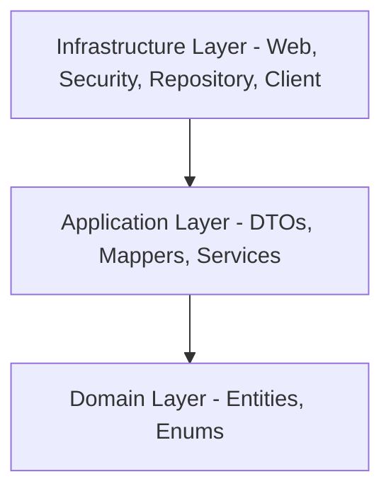

# FocusAdapt API

FocusAdapt API is a Spring Boot 3 & Java 21 REST backend designed to mitigate academic procrastination through gamification, study session management, and adaptive AI-driven scheduling powered by the Gemini API.

---

## Architecture Overview

The project is built following the principles of **Clean Architecture** and **DDD (Domain-Driven Design)**, ensuring low coupling and high maintainability:

- **Domain Layer**: Contains JPA core entities (`User`, `StudyPlan`, `Mission`, `Badge`) and domain-level enums (`ProcrastinationProfileType`, `StudySessionStatus`). Fully isolated from frameworks.
- **Application Layer**: Contains business flow services (`QuestionnaireServiceImpl`, `StudySessionServiceImpl`), MapStruct mappers, and data transfer objects (DTOs).
- **Infrastructure Layer**: Contains database repositories, JWT filters, security configurations, and the `GeminiClient` adapter.

---

## Getting Started

### Prerequisites
- **Java 21 JDK**
- **Docker & Docker Compose** (for containerized execution)
- **Maven** (packaged via `./mvnw`)

### Configuration (Environment Variables)
The application reads the following variables from the environment with sensible fallbacks:

| Variable | Description | Default (Dev) |
|---|---|---|
| `SPRING_PROFILES_ACTIVE` | Active Spring profile (`dev` or `prod`) | `dev` |
| `PORT` | API Server port | `8080` |
| `DB_HOST` | Database host name | `localhost` |
| `DB_PORT` | Database connection port | `5432` |
| `DB_NAME` | PostgreSQL database name | `focusadapt` |
| `DB_USER` | Database user name | `postgres` |
| `DB_PASSWORD` | Database password | `postgres` |
| `JWT_SECRET_KEY` | HMAC-SHA256 signing secret | `dGhpcy1...` (Auto fallback) |
| `GEMINI_API_KEY` | Google Gemini API client key | `mock-api-key` |

---

## Execution Profiles

The API separates environment parameters through profile files:

### 1. Development Profile (`dev`)
Runs the database using automatic JPA schema generation (`ddl-auto=update`), console SQL printing, and fully exposed monitoring endpoints.
- **Run script (Windows)**: `run-dev.bat`
- **Run script (Linux/macOS)**: `./run-dev.sh`
- **Swagger Documentation**: Available at `http://localhost:8080/api/swagger-ui.html`

### 2. Production Profile (`prod`)
Enforces database schema validation via Hibernate, outputs structured JSON logs for cloud aggregation (ELK/CloudWatch), locks down Swagger UI, and secures Actuator metrics.
- **Run script (Windows)**: `docker-build-run.bat`
- **Run script (Linux/macOS)**: `./docker-build-run.sh`
- **Compose Stack configuration**: `compose.prod.yaml`

---

## Key Features & Endpoints

All data endpoints (except authentication routes) require JWT Bearer authorization.

### 1. Authentication (`/v1/auth`)
- `POST /v1/auth/register`: Create user account.
- `POST /v1/auth/login`: Authenticate and obtain Access + Refresh tokens.
- `POST /v1/auth/refresh`: Rotate expired Access token.
- `POST /v1/auth/logout`: Blacklist refresh token.

### 2. Diagnostic Questionnaire (`/v1/questionnaires`)
- `POST /v1/questionnaires/{id}/submit`: Process diagnostic questionnaire answers, calculate procrastination profile, and trigger Gemini AI to create study plans and personalized missions.

### 3. Study Sessions (`/v1/study-sessions`)
- `POST /v1/study-sessions`: Start a session.
- `PUT /v1/study-sessions/{id}`: Complete session, trigger XP scoring (+50 base, +20 Pomodoro bonus), update user streak, and evaluate active achievements.

### 4. Interactive Dashboard (`/v1/dashboard`)
- `GET /v1/dashboard`: Compiles userName, streak, XP points, current study plan, active missions, unlocked badges, and unread notifications.

---

## Production Health & Metrics (Actuator)

In the production environment, metrics scraping is secured:
- **Health check**: `GET /api/actuator/health` (Public status check)
- **Info metadata**: `GET /api/actuator/info` (Public version check)
- **Prometheus Metrics**: `GET /api/actuator/prometheus` (Restricted to `ADMIN` role users)
